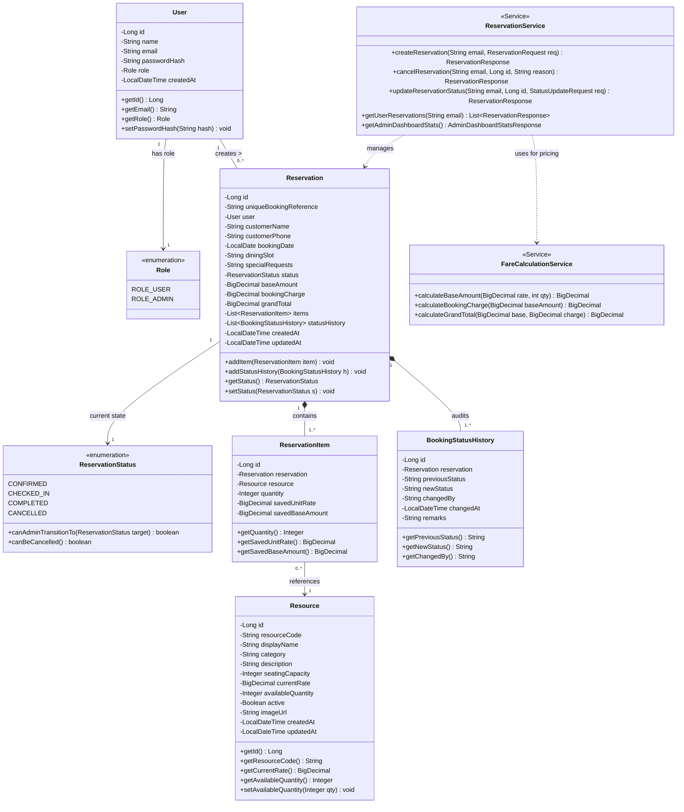

# UML Class Diagram
## Restaurant Table Reservation System

---

## 1. Class Diagram Overview
The class diagram visualizes the entity domain model, encapsulation of business attributes, relationships, multiplicity constraints, and core behavioral methods across the Spring Boot backend architecture.

---

## 2. Mermaid UML Class Diagram

---

## 3. Multiplicities and Constraints
1. **User to Reservation (`1 : 0..*`):** A user can make zero or many reservations; every reservation belongs to exactly one user.
2. **Reservation to ReservationItem (`1 : 1..*`):** A reservation contains at least one line item capturing the specific table resource and rate snapshot.
3. **Reservation to BookingStatusHistory (`1 : 1..*`):** Every reservation has at least one status history record created at confirmation, plus additional entries for each lifecycle transition.
4. **ReservationItem to Resource (`* : 1`):** Many reservation items can reference the same catalog table resource over time. The item stores a decoupled snapshot of the rate (`savedUnitRate`), ensuring historical immutability.
