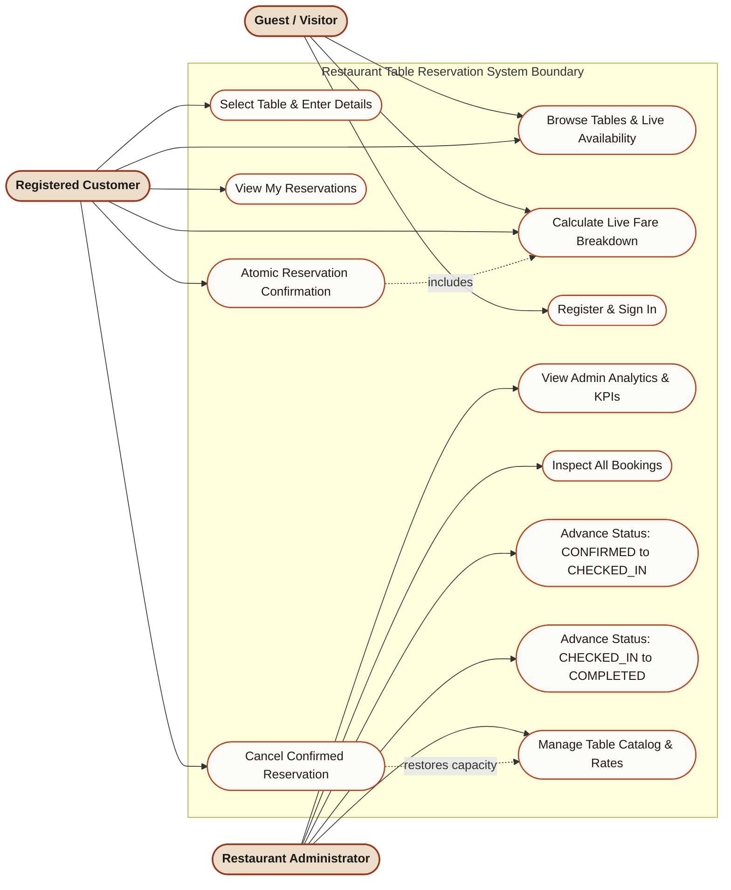

# UML Use Case Diagram
## Restaurant Table Reservation System

---

## 1. System Boundary & Actor Description
- **Guest / Unregistered Customer:** Browses tables, views live availability, and calculates live fares.
- **Registered Customer (User):** Performs reservations, views personal bookings, inspects immutable fare receipts, and cancels eligible confirmed reservations.
- **Administrator:** Inspects all restaurant reservations, manages table catalog rates & capacities, and advances operational statuses through the strict sequence `CONFIRMED → CHECKED_IN → COMPLETED`.

---

## 2. Mermaid UML Use Case Diagram

---

## 3. Use Case Specifications Summary

| Use Case ID | Name | Primary Actor | Preconditions | Postconditions |
| :--- | :--- | :--- | :--- | :--- |
| **UC-01** | Browse Tables | Guest / User | System running | Active tables with remaining capacity displayed |
| **UC-02** | Calculate Fare | Guest / User | Table selected, quantity 1–5 | Base amount, booking charge (₹50/₹0), grand total returned |
| **UC-03** | Authenticate | Guest | Valid email & password | JWT token issued, user state loaded |
| **UC-05** | Confirm Reservation | User | User logged in, inventory > 0 | Atomic booking created, inventory reduced, rate snapshotted |
| **UC-07** | Cancel Booking | User | Booking in `CONFIRMED` status | Status set to `CANCELLED`, table capacity restored exactly once |
| **UC-10/11** | Advance Operational Status | Admin | Booking in preceding state | Advanced to next state (`CHECKED_IN` or `COMPLETED`) with audit log |
| **UC-12** | Manage Table Catalog | Admin | Admin authenticated | Table current rate or available quantity modified |
